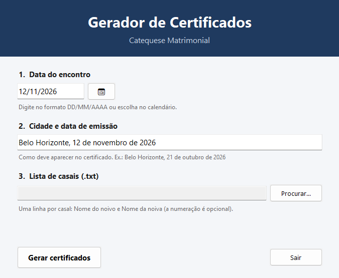
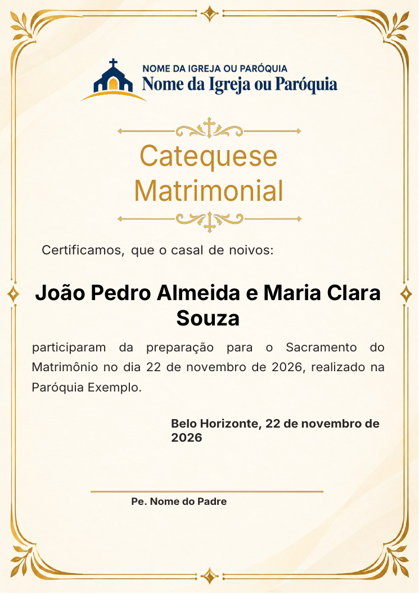

# Gerador de Certificados — Catequese Matrimonial


Aplicativo desktop que gera, em poucos cliques, **um certificado por casal** a partir de um modelo Word (`.docx`) e de uma lista de nomes em `.txt`. O resultado é um único arquivo Word com um certificado por página, pronto para revisar e imprimir.

> **Projeto em uso real:** desenvolvido para automatizar a emissão de certificados da Catequese Matrimonial de uma paróquia, onde cada encontro reúne cerca de 50 casais. Esta é a versão genérica, sem a identidade visual nem os dados da instituição, publicada como portfólio.

## Demonstração

<table>
  <tr>
    <td align="center"><b>Tela inicial</b></td>
    <td align="center"><b>Certificado gerado</b></td>
  </tr>
  <tr>
    <td align="center"></td>
    <td align="center"></td>
  </tr>
</table>

*À esquerda, a tela inicial com os três passos: data do encontro (com calendário), cidade/data de emissão e lista de casais. À direita, um certificado gerado com dados fictícios.*

## O problema

Cada encontro exige um certificado individual por casal. Fazer isso à mão significa abrir o modelo, trocar nomes e datas, duplicar páginas e conferir tudo, dezenas de vezes e sem margem para erro de digitação. O aplicativo transforma esse processo em três campos e um botão.

## Funcionalidades

- **Interface gráfica simples**, com tela inicial em três passos: data do encontro, cidade/data de emissão e lista de casais.
- **Seletor de data com calendário** (navegação por mês, botões *Hoje* e *Limpar*) ou digitação manual no formato `DD/MM/AAAA`.
- **Data por extenso** gerada automaticamente em português (`22 de novembro de 2026`).
- **Lista de casais em `.txt`**, com ou sem numeração. Linhas vazias são ignoradas e não há limite de quantidade.
- **Preserva a formatação do modelo**: fonte, tamanho e posição vêm do `.docx`, então o layout pode ser editado direto no Word.
- **Modelo tolerante a edições**: os campos são reconhecidos por padrão de texto, e não por frases fixas. Trocar o nome da igreja ou do padre no modelo não quebra o programa.
- **Mensagens de erro claras** para data inválida, linha de casal mal formatada ou campo ausente no modelo.
- **Executável para Windows** (`.exe`), sem precisar instalar Python no computador de quem usa.

## Como usar

### Opção 1: executável (Windows)

1. Baixe o `.exe` na aba **Releases**.
2. Coloque `modelo_certificado.docx` na **mesma pasta** do executável.
3. Abra o programa, preencha os campos e clique em **Gerar certificados**.
4. O arquivo é salvo em `certificados_gerados/`, ao lado do executável.

### Opção 2: código-fonte

```bash
git clone https://github.com/<seu-usuario>/gerador-certificados-catequese.git
cd gerador-certificados-catequese
py -m pip install -r requirements.txt
py gerador_certificados.py
```

Requer Python 3.10 ou superior com Tkinter (já incluso no instalador oficial para Windows).

## Formato da lista de casais

Uma linha por casal, no formato `Nome do noivo e Nome da noiva`. A numeração é opcional:

```text
1. João Pedro Almeida e Maria Clara Souza
2. Carlos Eduardo Ribeiro e Ana Beatriz Lima
Rafael Martins e Juliana Ferreira Costa
```

Há um arquivo de exemplo em [`exemplos/lista_casais_exemplo.txt`](exemplos/lista_casais_exemplo.txt).

## Como o modelo é preenchido

O programa localiza três pontos no `modelo_certificado.docx` e troca apenas o conteúdo deles:

| Campo | Como é reconhecido no modelo |
| --- | --- |
| Nomes do casal | Parágrafo com o texto `Nome do Noivo e Nome da Noiva` |
| Data do encontro | Parágrafo `participaram da preparação...`; só a data depois de `no dia` é trocada |
| Cidade e data de emissão | Linha no formato `Cidade, DD de mês de AAAA.` |

O restante do certificado (logotipo, nome da igreja, nome do padre, molduras) continua exatamente como está no modelo.

## Estrutura do projeto

```text
gerador-certificados-catequese/
├── gerador_certificados.py        # aplicativo (lógica + interface)
├── modelo_certificado.docx        # modelo do certificado
├── requirements.txt
├── gerador_certificados.spec   # configuração do PyInstaller
├── assets/
│   └── gerador-certificados.ico   # ícone do executável
├── exemplos/
│   └── lista_casais_exemplo.txt
└── docs/                          # imagens usadas neste README
```

## Gerar o executável

```bash
py -m pip install pyinstaller
py -m PyInstaller gerador_certificados.spec
```

O arquivo `gerador-certificados.exe` é criado em `dist/`. Lembre-se de distribuí-lo junto com o `modelo_certificado.docx`.

## Tecnologias e destaques técnicos

- **Python 3**, **Tkinter/ttk** e **python-docx** para ler e editar o Word.
- **docxcompose** para juntar dezenas de documentos em um só, mantendo estilos e molduras.
- **Expressões regulares** para identificar os campos do modelo e para ler a lista de casais com numeração opcional.
- **Widget de calendário próprio**, escrito apenas com Tkinter e o módulo `calendar`, sem dependências extras e sem problemas de empacotamento.
- Interface com cabeçalho, seções numeradas e validação com mensagens em português.
- **PyInstaller** configurado para empacotar `docx` e `docxcompose` em um único executável.
- Tratamento de caminhos que funciona tanto no código-fonte quanto no executável.

## Autor

Feito por **Matheus Honorato Leite Teixeira**, estudante de Sistemas de Informação.
[LinkedIn](https://www.linkedin.com/in/matheus-honorato-lt/) · [GitHub](https://github.com/MatheusHLT)
